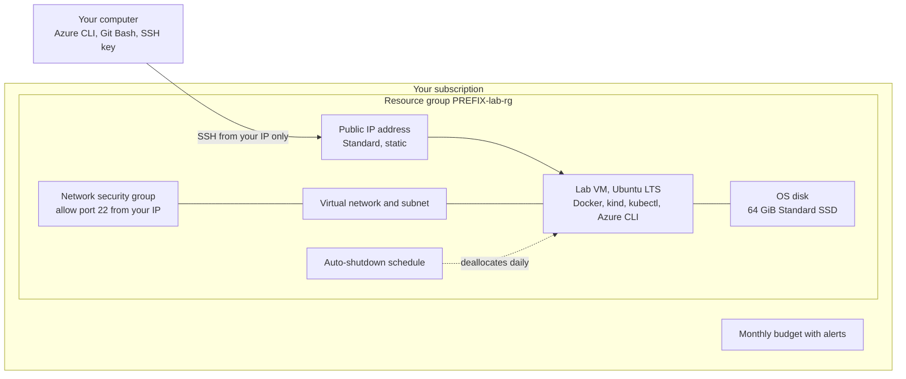

# Chapter 0: lab setup

Every lab in this course runs on Azure, from a small Linux virtual machine (VM) in your own subscription. This chapter builds that VM and the guardrails that protect your monthly credit, then checks that everything later chapters need is in place.

## What you will be able to do

- Explain how your credit-based subscription is billed and what happens when the credit runs out.
- Name the five cost guardrails of the course and say what each one does and does not do.
- Create the lab environment from code with one script, and stop or destroy it with another.
- Connect to the lab VM over SSH, from your own public IP address only.
- Read a readiness report and decide what to fix now and what can wait.

## Before you start

### Prerequisites

- An Azure subscription where you have the Owner role. Setup creates role assignments, which needs Owner (or User Access Administrator). A Visual Studio subscription with monthly credit fits, with the spending limit left on.
- On your own computer:
  - the [Azure CLI](https://learn.microsoft.com/cli/azure/install-azure-cli), signed in with `az login`,
  - [Git](https://git-scm.com/downloads). On Windows, Git for Windows also installs Git Bash, the terminal you use to run the course scripts,
  - an OpenSSH client. It ships with macOS, Linux and [Windows 10 and 11](https://learn.microsoft.com/windows-server/administration/openssh/openssh_install_firstuse), and Git Bash includes one.
- The course files on your computer, cloned with Git or downloaded as a zip file.

If subscriptions, resource groups or regions are new to you, take the [Azure Fundamentals cloud concepts path](https://learn.microsoft.com/training/paths/az-900-describe-cloud-concepts/) on Microsoft Learn first.

### Time needed

About 90 minutes: 40 minutes of reading, 10 minutes of preparation, 15 minutes of waiting while Azure builds the VM and installs the tools, and 25 minutes for the lab task.

### Estimated cost

Prices from the Azure Retail Prices API, pay-as-you-go, Linux, region Sweden Central, in EUR, looked up on 13 November 2026. Setup looks them up again for your own region and currency before it changes anything.

| Item | Price | When you pay |
| --- | --- | --- |
| Lab VM `Standard_D2as_v5` (2 vCPUs, 8 GiB of memory) | 0.0826 per hour | Only while the VM runs |
| OS disk, 64 GiB Standard SSD (E6) | 4.3090 per month, plus 0.0018 per 10,000 disk operations | All the time, even when the VM is stopped |
| Public IPv4 address, Standard, static | 0.0044 per hour | All the time, even when the VM is stopped |
| Budget, auto-shutdown schedule, resource group, network | No meter found in the price list (not verified for the auto-shutdown schedule) | Never |

For this chapter, a one-hour session costs about 0.08 for the VM, plus about 0.25 per day for the disk and the IP address for as long as the VM exists. If you keep the lab VM for a month and use it 2 hours a day, expect about 13 EUR, roughly 10% of a 130 EUR credit.

## Concepts

### How your subscription is billed

Azure bills each resource through meters. A VM is billed per hour of running time, a managed disk per month (shared out over the hours it exists), a static public IP address per hour, and a container registry per day. You can see every meter and its price in the [Azure Retail Prices API](https://learn.microsoft.com/rest/api/cost-management/retail-prices/azure-retail-prices), which is where every price in this course comes from.

On a credit-based subscription, such as the monthly credit that comes with a Visual Studio subscription, usage is charged against the credit. Three facts shape every lab in this course:

- With the spending limit on, Azure disables your services for the rest of the billing period once the credit is spent. The documentation describes VMs being stopped and deallocated and storage becoming read-only. For subscriptions with a monthly credit, the subscription is re-enabled at the start of the next billing period. [Spending limit](https://learn.microsoft.com/azure/cost-management-billing/manage/spending-limit)
- Some charges, such as most third-party Marketplace offers, are never covered by the credit, even with the spending limit on. [Spending limit](https://learn.microsoft.com/azure/cost-management-billing/manage/spending-limit)
- Credit-based subscriptions can have lower default quotas than paid ones, and some regions or services may not be available to them. [Visual Studio credit](https://azure.microsoft.com/pricing/member-offers/credit-for-visual-studio-subscribers/)

Treat the spending limit as a last resort: when it triggers, it stops everything at once, including the lab you were in the middle of.

<details>
<summary>Check yourself: your credit runs out on the 20th of the month. What happens to the lab VM, and when can you use it again?</summary>

Azure disables your services and stops and deallocates the VM. You can start it again once the subscription is re-enabled, at the beginning of the next billing period. Your disk is kept, so your work is still there.

</details>

### Stopped is not the same as deallocated

A VM has several power states, and they are not billed the same way. [States and billing of Azure VMs](https://learn.microsoft.com/azure/virtual-machines/states-billing)

| Power state | How you get there | Compute billed? |
| --- | --- | --- |
| Running | Start the VM | Yes |
| Stopped | Shut the operating system down from inside the VM, for example `sudo poweroff` | Yes, Azure still reserves the hardware |
| Deallocated | Stop the VM through Azure: the portal Stop button, `az vm deallocate`, or auto-shutdown | No |

In every state, the disk and the static public IP address are still billed. Only deleting them stops those charges.

The course always stops the VM through Azure (`teardown.sh stop` or `scripts/lab-vm.sh stop`), never from inside it.

<details>
<summary>Check yourself: you typed sudo poweroff in the VM and the portal now shows "Stopped". Are you still paying for compute?</summary>

Yes. A VM shut down from inside the operating system keeps its hardware reservation and is still billed for compute. Deallocate it from your own computer with `chapters/00-lab-setup/lab/teardown.sh stop`.

</details>

### The five guardrails of the course

Each guardrail covers a different failure. None of them is enough on its own.

| Guardrail | What it does | What it does not do |
| --- | --- | --- |
| Spending limit | Stops all services when the credit is spent | Warn you early, or stop at a lower amount |
| Budget with alerts | E-mails you at 50%, 80% and 100% of the budget in actual cost, and at 100% in forecast cost | Stop anything. Cost data arrives 8 to 24 hours late and budgets are evaluated once a day |
| Auto-shutdown | Deallocates the lab VM every day at a fixed time | Stop the disk and IP charges, or stop any other resource |
| Teardown scripts | Delete what a lab created | Anything at all if you do not run them |
| Tags `course=aro-k8s` and `chapter=NN` | Let teardown and cost analysis find every course resource | Cover resource types that do not accept tags |

The budget alerts are described in [Create and manage budgets](https://learn.microsoft.com/azure/cost-management-billing/costs/tutorial-acm-create-budgets). A forecast alert is the early warning: it fires when Azure predicts that your spending will reach the threshold by the end of the month, before the money is actually spent. Auto-shutdown deallocates the VM, as described in [Plan to manage Azure costs](https://learn.microsoft.com/azure/cost-management-billing/understand/plan-manage-costs#optimize-and-reduce-costs).

The budget in this course covers the whole subscription, not only the lab resource group, so that it also catches resources created outside the course.

<details>
<summary>Check yourself: you forget the lab VM running on a Friday evening. Which guardrail stops the cost, and which one tells you about it?</summary>

Auto-shutdown deallocates the VM at the time set in `.env`, which stops the compute cost that evening. The budget would only tell you if the total spending crossed a threshold, and with a delay of up to a day. The disk and IP address keep costing a few cents a day until you destroy the lab.

</details>

### Infrastructure as code with Bicep

Setup creates the lab from [Bicep](https://learn.microsoft.com/azure/azure-resource-manager/bicep/overview) files rather than from clicks in the portal. Bicep is a declarative language: the files describe the end state you want (a resource group, a budget, a VM with these settings), and Azure Resource Manager works out what to create or change to reach it. Running the same deployment twice gives the same result, which is why setup is safe to run again, for example after your public IP address changes.

You will meet the same idea, describing the desired state and letting the platform converge, in chapter 2 with Kubernetes.

The lab environment looks like this:



The files are in [lab/infra](lab/infra): `main.bicep` creates the resource group and the budget at subscription level, and `lab.bicep` creates the network, the VM, the auto-shutdown schedule and the role assignments inside the resource group.

On its first boot, the VM runs [cloud-init](https://learn.microsoft.com/azure/virtual-machines/linux/using-cloud-init), a standard tool that configures a Linux machine from a file. The file in [lab/infra/cloud-init.yaml](lab/infra/cloud-init.yaml) installs the tools of chapters 1 and 2:

- Docker Engine, a container engine: the program that builds and runs containers (chapter 1 explains what a container is).
- kind, a tool that runs a small Kubernetes cluster inside containers (chapter 2).
- kubectl, the command-line client of Kubernetes (chapter 2).
- The Azure CLI, so that scripts on the VM can work with Azure.

<details>
<summary>Check yourself: your public IP address changed and you run setup.sh again. What does the second run do to the VM?</summary>

It keeps the VM and its disk, and updates what differs from the files, here the source address in the network security group rule. Bicep describes the end state, so resources that already match are left as they are.

</details>

### Reaching the lab VM safely

You connect with SSH, using a key pair instead of a password. The private key stays on your computer. The public key is copied to the VM when it is created, and password sign-in is turned off. Azure accepts RSA keys of at least 2048 bits and Ed25519 keys. [SSH keys for Linux VMs](https://learn.microsoft.com/azure/virtual-machines/linux/mac-create-ssh-keys)

A network security group (NSG) filters traffic to the VM. The course adds one rule: TCP port 22 (SSH) is allowed from your public IP address with the suffix `/32`, which means that single address and nothing else. All other inbound traffic from the internet is denied by the default rules of every NSG. If your IP address changes, update `LEARNER_IP` in `.env` and run setup again. [Network security groups](https://learn.microsoft.com/azure/virtual-network/network-security-groups-overview)

The VM also has a managed identity: an identity in Microsoft Entra ID that belongs to the VM itself. Scripts on the VM sign in with `az login --identity`, so no password or token is ever stored on the VM. The identity has two roles, both limited to the lab resource group: Contributor, so that chapter scripts can create and delete their resources there, and AcrPush, so that you can push container images in chapter 1. Chapter 4 comes back to why limiting the scope of a role matters. [Managed identities](https://learn.microsoft.com/entra/identity/managed-identities-azure-resources/overview)

If your network blocks outgoing SSH, [Azure Bastion Developer](https://learn.microsoft.com/azure/bastion/quickstart-developer) is a free alternative in many regions, including Sweden Central. It opens a terminal in your browser through the portal, without any public port, but it does not support native SSH clients or file copies, and allows one connection at a time. [Bastion SKU comparison](https://learn.microsoft.com/azure/bastion/bastion-sku-comparison)

<details>
<summary>Check yourself: why does the NSG rule end in /32, and what happens when you work from another network?</summary>

`/32` limits the rule to exactly one IPv4 address. From another network, your public address is different, so the VM refuses the connection. Update `LEARNER_IP` in `.env` and run setup again.

</details>

### Quotas, regions and resource providers

Azure limits how many vCPUs (virtual processors) you can run, at two levels in each region: a total for the region, and a limit per VM family, such as the DASv5 family of the lab VM. A deployment fails if it would exceed either one. [Check vCPU quotas](https://learn.microsoft.com/azure/virtual-machines/quotas)

The lab VM needs 2 vCPUs. The big number comes later: creating an ARO cluster needs at least 44 cores at install time (8 for a temporary bootstrap machine, 24 for the control plane, 12 for the workers), and 36 once the install is done. With the default sizes, those cores come from the DSv5 family. [Create an ARO cluster](https://learn.microsoft.com/azure/openshift/create-cluster) Credit-based subscriptions often start with a lower limit. The readiness report shows this as a warning, not a failure, because nothing before chapter 8 needs it.

The default region of the course is Sweden Central. In November 2026 it was the cheapest of four European regions compared for the lab VM size, and it offers AKS and ARO. The region is a setting in `.env`, and the readiness report checks that your region offers the VM size, AKS and ARO for your subscription.

Each Azure service is delivered by a resource provider, such as `Microsoft.Compute` for VMs. A subscription must register a provider before it can use it. Setup registers every provider the course uses, which costs nothing. [Resource providers](https://learn.microsoft.com/azure/azure-resource-manager/management/resource-providers-and-types)

<details>
<summary>Check yourself: the readiness report warns that your regional vCPU limit is 20. Can you go on with chapter 1?</summary>

Yes. Chapters 1 to 7 need far fewer vCPUs. Before chapter 8, request a higher limit, and read that chapter's notes on what to do if a credit-based subscription cannot get it.

</details>

## Knowledge check

Answers and explanations are in [knowledge-check-answers.md](knowledge-check-answers.md).

1. The portal shows your lab VM as "Stopped" after you ran `sudo poweroff` inside it. What are you paying for?
   - A. Nothing, the VM is off.
   - B. Compute, the disk and the public IP address.
   - C. Only the disk.
   - D. Only the public IP address.
2. Your budget reaches 100% of its amount in actual cost. What does Azure do?
   - A. It deallocates every VM in the subscription.
   - B. It disables the subscription until next month.
   - C. It sends an e-mail to the budget contacts and changes nothing else.
   - D. It deletes the resources tagged by the budget.
3. Your monthly credit is spent on the 20th and the spending limit is on. What happens?
   - A. Azure charges the rest of the month to your bank card.
   - B. Your services are disabled until the next billing period, and VMs are stopped and deallocated.
   - C. Only new deployments are blocked, running VMs carry on.
   - D. The subscription is deleted with all its resources.
4. Which of these still costs money after `teardown.sh stop`?
   - A. The VM compute time.
   - B. The OS disk and the static public IP address.
   - C. Nothing, stop removes all charges.
   - D. Only the budget.
5. Why does setup create a managed identity for the lab VM?
   - A. So that scripts on the VM can call Azure without storing a password or token on the VM.
   - B. So that you can sign in to the VM without an SSH key.
   - C. So that the VM can reach the internet.
   - D. So that the budget alerts reach the VM.

## Lab

### Goal

Build your lab environment from code, connect to it from your own computer only, and get a readiness report with no failed check.

### Acceptance criteria

- `validate.sh` reports no `[FAIL]`. Warnings are allowed, as long as you can explain each one.
- You can open an SSH session on the lab VM from your computer with `scripts/lab-vm.sh connect`, and run `docker version`, `kind version` and `kubectl version --client` there.
- You have found the budget in the portal (Cost Management, Budgets) and the auto-shutdown setting on the VM (Operations, Auto-shutdown), and you know at what time the VM shuts down.
- For each `[WARN]` in your report, you have written one sentence: what it means and whether it matters before chapter 8.
- At the end of your session, the VM is deallocated.

### Prepare

Run these on your own computer. On Windows, use Git Bash for every command in this course.

1. Sign in to Azure and check which subscription the CLI uses. If it is the wrong one, select the right one with `az account set --subscription "<name>"`.

   ```bash
   az login
   az account show --query "{name:name, state:state}" --output table
   ```

2. Create an SSH key pair for the course, in your own `.ssh` folder. Never copy the private key anywhere else. If you set a passphrase (recommended), load the key into your SSH agent once per terminal session, as described in [SSH keys for Linux VMs](https://learn.microsoft.com/azure/virtual-machines/linux/create-ssh-keys-detailed).

   ```bash
   ssh-keygen -t ed25519 -f ~/.ssh/aro-k8s-lab -C aro-k8s-lab
   ```

3. In the course folder, copy `.env.example` to `.env` and fill it in. At least set `LEARNER_IP` to your current public IPv4 address, which any "what is my IP" web page shows. Read the comment above each setting.

### Run setup, validate and teardown

From the course folder on your computer:

```bash
chapters/00-lab-setup/lab/setup.sh        # creates or updates everything, asks before changing anything
chapters/00-lab-setup/lab/validate.sh     # readiness report, changes nothing
scripts/lab-vm.sh connect                 # SSH session on the lab VM, type exit to leave
chapters/00-lab-setup/lab/teardown.sh stop
```

Setup prints the estimated cost, asks for confirmation, registers the resource providers, creates the budget and deploys the Bicep files. It then waits for SSH and for cloud-init, which takes 5 to 10 minutes on the first run, and copies the course files to `~/aro-k8s-course` on the VM.

Next time you work on the course, start the VM with `scripts/lab-vm.sh start`. If you edit `.env` or update the course files on your computer, copy them to the VM again with `scripts/lab-vm.sh sync`. Your own work on the VM, in `~/work`, is never overwritten.

### Review

Open [review-prompt.md](review-prompt.md), copy the prompt into any AI assistant, and paste the full output of `validate.sh` and your sentences about the warnings where the prompt says so. Before you paste anything, remove your subscription name if you consider it private. The report never prints keys, IDs or IP addresses other than the ones in your own `.env`.

## Clean up and cost check

- At the end of every session, deallocate the VM: `chapters/00-lab-setup/lab/teardown.sh stop`. Keep the environment, chapter 1 needs it.
- When you stop following the course for more than a few weeks, destroy everything: `chapters/00-lab-setup/lab/teardown.sh destroy`. It deletes the resource group and the budget, then lists anything still tagged `course=aro-k8s`. Azure may also have created a resource group called `NetworkWatcherRG` when the network was created. It has no cost on its own and you can keep it. [Network Watcher](https://learn.microsoft.com/azure/network-watcher/network-watcher-create)
- A day later, open Cost Management, Cost analysis, and filter on the tag `course=aro-k8s`. Costs appear with a delay of up to a day. For a one-hour session, expect well under 1 EUR.

## Sources

Prices: [Azure Retail Prices API](https://learn.microsoft.com/rest/api/cost-management/retail-prices/azure-retail-prices), queried on 13 November 2026 with filters such as `armSkuName eq 'Standard_D2as_v5' and armRegionName eq 'swedencentral'`, currency EUR.

- [Azure spending limit](https://learn.microsoft.com/azure/cost-management-billing/manage/spending-limit)
- [Monthly Azure credit for Visual Studio subscribers](https://azure.microsoft.com/pricing/member-offers/credit-for-visual-studio-subscribers/)
- [Understand Cost Management data](https://learn.microsoft.com/azure/cost-management-billing/costs/understand-cost-mgt-data)
- [Create and manage budgets](https://learn.microsoft.com/azure/cost-management-billing/costs/tutorial-acm-create-budgets)
- [Microsoft.Consumption budgets, Bicep reference](https://learn.microsoft.com/azure/templates/microsoft.consumption/budgets)
- [States and billing status of Azure VMs](https://learn.microsoft.com/azure/virtual-machines/states-billing)
- [Auto-shutdown a virtual machine](https://learn.microsoft.com/azure/virtual-machines/auto-shutdown-vm)
- [Plan to manage Azure costs](https://learn.microsoft.com/azure/cost-management-billing/understand/plan-manage-costs)
- [Microsoft.DevTestLab schedules, Bicep reference](https://learn.microsoft.com/azure/templates/microsoft.devtestlab/schedules)
- [What is Bicep?](https://learn.microsoft.com/azure/azure-resource-manager/bicep/overview)
- [cloud-init support for Linux VMs in Azure](https://learn.microsoft.com/azure/virtual-machines/linux/using-cloud-init)
- [Quick steps: SSH keys for Linux VMs](https://learn.microsoft.com/azure/virtual-machines/linux/mac-create-ssh-keys)
- [Detailed steps: SSH keys for Linux VMs](https://learn.microsoft.com/azure/virtual-machines/linux/create-ssh-keys-detailed)
- [Network security groups](https://learn.microsoft.com/azure/virtual-network/network-security-groups-overview)
- [Managed identities for Azure resources](https://learn.microsoft.com/entra/identity/managed-identities-azure-resources/overview)
- [Azure Bastion Developer quickstart](https://learn.microsoft.com/azure/bastion/quickstart-developer) and [SKU comparison](https://learn.microsoft.com/azure/bastion/bastion-sku-comparison)
- [Check vCPU quotas](https://learn.microsoft.com/azure/virtual-machines/quotas)
- [Increase VM-family vCPU quotas](https://learn.microsoft.com/azure/quotas/per-vm-quota-requests)
- [Create an Azure Red Hat OpenShift cluster](https://learn.microsoft.com/azure/openshift/create-cluster)
- [Azure Red Hat OpenShift service definitions](https://learn.microsoft.com/azure/openshift/openshift-service-definitions)
- [Resource providers and types](https://learn.microsoft.com/azure/azure-resource-manager/management/resource-providers-and-types)
- [Network Watcher, automatic enablement](https://learn.microsoft.com/azure/network-watcher/network-watcher-create)
- [Install Docker Engine on Ubuntu](https://docs.docker.com/engine/install/ubuntu/)
- [Install the Azure CLI on Linux](https://learn.microsoft.com/cli/azure/install-azure-cli-linux)
- [Install kubectl on Linux](https://kubernetes.io/docs/tasks/tools/install-kubectl-linux/)
- [kind quick start](https://kind.sigs.k8s.io/docs/user/quick-start/) and [known issues](https://kind.sigs.k8s.io/docs/user/known-issues/)
