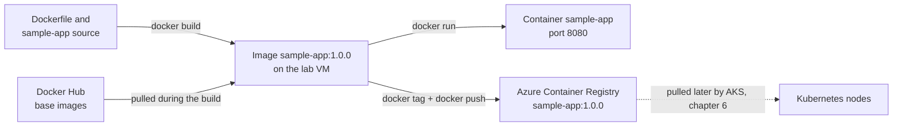

# Chapter 1: containers

Kubernetes and OpenShift run containers, so everything in the rest of the course builds on this chapter. You will package the course sample app as a container image, run it on the lab VM, and publish it to a registry in Azure.

## What you will be able to do

- Explain the difference between an image and a container, and between a tag and a digest.
- Write a Dockerfile with two stages that produces a small image running as a non-root user.
- Build, run, inspect and debug a container with the Docker command line: ports, logs, exec, history.
- Push an image to Azure Container Registry and prove that the registry holds exactly the image you built.

## Before you start

### Prerequisites

- Chapter 0 done: the readiness report has no `[FAIL]`.
- The lab VM started (`scripts/lab-vm.sh start`) and an SSH session open on it (`scripts/lab-vm.sh connect`).

### Time needed

About 2.5 hours: 60 minutes of reading, 75 minutes for the lab, 15 minutes for the review.

### Estimated cost

Prices from the Azure Retail Prices API, pay-as-you-go, region Sweden Central, in EUR, looked up on 13 November 2026.

| Item | Price | For this chapter |
| --- | --- | --- |
| Lab VM, about 2 hours | 0.0826 per hour | 0.17 |
| Azure Container Registry, Basic tier, 10 GiB of storage included | 0.1431 per day | 0.14 if you delete it the same day |
| Disk and public IP of the lab VM | about 0.25 per day | 0.25 |

About 0.56 EUR in total. Setup prints the registry price for your own region and currency before it creates anything. The registry is deleted by the teardown script at the end of the chapter, and a new one comes back in chapter 6.

## Concepts

### Images and containers

A container is a normal Linux process that the kernel isolates from the rest of the machine. Two kernel features do the work: namespaces give the process its own view of the file system, the network and the process list, and control groups (cgroups) limit how much CPU and memory it can use. There is no second operating system inside, which is why a container starts in a fraction of a second, unlike a VM.

An image is the template a container starts from. It holds a file system (the app and everything it needs) and metadata: which command to run, which user to run it as, which port the app listens on. An image never changes. When a container starts, the engine adds a thin writable layer on top of the image for that container only. When the container is removed, that layer is gone.

The program that builds images and runs containers is a container engine. The lab VM uses Docker Engine. Podman, which you meet again with OpenShift in chapter 7, is another one. Both follow the Open Container Initiative (OCI) image format, so an image built by one runs on the other, and on Kubernetes. [Docker overview](https://docs.docker.com/get-started/docker-overview/), [OCI image specification](https://github.com/opencontainers/image-spec)

<details>
<summary>Check yourself: you start three containers from the same image and write a file in one of them. Do the two others see it? Does the image change?</summary>

No and no. Each container has its own writable layer on top of the shared, read-only image. The file exists only in the writable layer of the container that wrote it, and disappears when that container is removed.

</details>

### Layers and the build cache

An image is a stack of layers. Each instruction in a Dockerfile that changes the file system, such as `COPY` or `RUN`, produces one layer that records only the changes. Layers are identified by their content, so two images based on the same parent share its layers on disk and in the registry. [Understanding image layers](https://docs.docker.com/get-started/docker-concepts/building-images/understanding-image-layers/)

When you build again, Docker reuses a layer from its cache if the instruction and its inputs have not changed. As soon as one layer changes, every layer after it is rebuilt. The order of the instructions therefore decides how fast a rebuild is: put what changes rarely (the base image, the dependency list) first, and what changes often (your code) last. [Docker build cache](https://docs.docker.com/build/cache/)

`docker image history <image>` lists the layers of an image with the instruction that created each one and its size.

<details>
<summary>Check yourself: a Dockerfile copies all the source code, then downloads the dependencies. You change one line of code. What is rebuilt?</summary>

The copy of the source code changed, so that layer and every layer after it are rebuilt, including the slow dependency download. Copying the dependency list first, downloading, and only then copying the code keeps the download in the cache.

</details>

### The Dockerfile

A Dockerfile is a text file with one instruction per line. These are the instructions this chapter needs. Each one is described in the [Dockerfile reference](https://docs.docker.com/reference/dockerfile/).

| Instruction | What it does |
| --- | --- |
| `FROM <image> AS <name>` | Starts a stage from a base image, and optionally names it |
| `WORKDIR <path>` | Sets the folder where the next instructions run |
| `COPY <source> <destination>` | Copies files from the build context (the folder you build from) into the image |
| `COPY --from=<stage> <source> <destination>` | Copies files from an earlier stage |
| `ARG <name>=<default>` | Declares a value you can pass at build time with `--build-arg` |
| `RUN <command>` | Runs a command during the build, for example a compiler |
| `USER <uid>:<gid>` | Sets the user the container runs as |
| `EXPOSE <port>` | Documents the port the app listens on. It does not open or publish anything |
| `ENTRYPOINT ["<executable>", "<argument>"]` | Sets the program the container runs |

A multi-stage build uses several `FROM` instructions. The first stage holds the full toolchain and compiles the app. The last stage starts from a small base and copies only the result from the first one. Everything else stays behind and never reaches the final image. [Multi-stage builds](https://docs.docker.com/build/building/multi-stage/)

The smallest possible base is `scratch`, an empty image. It works for a program that is a single static binary, such as the sample app built with `CGO_ENABLED=0`. It has no shell, no package manager and no user database, which also means there is very little for an attacker to use. Distroless images, which add only certificates, time zone data and a user list, are a common middle ground.

A `.dockerignore` file next to the Dockerfile lists files that must never be sent to the build, such as local binaries or secrets.

<details>
<summary>Check yourself: why does a two-stage build make the final image smaller, when it runs the same compiler?</summary>

The compiler runs in the first stage, and the final image only receives the files copied from it with `COPY --from`. The toolchain, the source code and the build cache stay in the first stage, which is discarded.

</details>

### Tags and digests

An image name has up to three parts: `<registry>/<repository>:<tag>`. For example, in `myregistry.azurecr.io/sample-app:1.0.0`, the registry is `myregistry.azurecr.io`, the repository is `sample-app` and the tag is `1.0.0`. Without a registry, Docker assumes Docker Hub. Without a tag, it assumes `latest`, which is only a default name, not a guarantee of anything recent.

A tag is a label that someone can move to another image at any time. A digest, such as `sha256:4f3c...`, is computed from the content of the image. It cannot move: the same digest always means the same bytes. Pulling `<repository>@<digest>` gives you exactly the image you tested. [Pull an image by digest](https://docs.docker.com/reference/cli/docker/image/pull/#pull-an-image-by-digest-immutable-identifier)

`docker tag` adds another name to an existing image. It copies nothing: both names point to the same image ID.

<details>
<summary>Check yourself: a colleague says "we deploy sample-app:1.0.0, so we always run the same code". What is wrong with that?</summary>

Anyone with push rights can push a different image under the same tag, so `1.0.0` may not be the image you tested. Only the digest identifies the content. Teams that need certainty deploy by digest, or protect tags in their registry.

</details>

### Registries and Azure Container Registry

A registry stores images and serves them to anything that needs to pull them: your VM, a Kubernetes cluster, a build pipeline. Docker Hub is the public default. Azure Container Registry (ACR) is a private registry in your subscription. [Azure Container Registry](https://learn.microsoft.com/azure/container-registry/container-registry-intro)

Each registry has a login server, `<registry name>.azurecr.io`. To push to it, you prefix the image name with the login server, sign in, and run `docker push`. On the lab VM, `az login --identity` signs the Azure CLI in with the VM's managed identity, then `az acr login --name <registry name>` exchanges that identity for a registry token that Docker uses. No password is ever typed or stored. The AcrPush role that chapter 0 gave the VM is what allows the push. [Authenticate with a managed identity](https://learn.microsoft.com/azure/container-registry/container-registry-authentication-managed-identity)

The registry of this chapter uses the Basic tier, the smallest one, with 10 GiB of storage included in the daily price. Its admin account, a shared user name and password, stays disabled: every push is then traceable to an identity. [ACR service tiers](https://learn.microsoft.com/azure/container-registry/container-registry-skus)

Docker Hub limits how many pulls anonymous users can make in a given time. The lab only pulls a few images, but a classroom behind one public IP address can hit the limit. [Docker Hub usage and limits](https://docs.docker.com/docker-hub/usage/)



<details>
<summary>Check yourself: your push fails with an authentication error, although az acr login succeeded. Which name did you probably push?</summary>

An image name without the login server prefix, such as `sample-app:1.0.0`. Docker then tries Docker Hub, where you are not signed in. The name must start with `<registry name>.azurecr.io/`.

</details>

### Running containers

These commands cover the lab. Each one has a page in the [Docker CLI reference](https://docs.docker.com/reference/cli/docker/).

| Command | What it does |
| --- | --- |
| `docker run -d --name <name> -p <host port>:<container port> <image>` | Starts a container in the background (`-d`), names it, and publishes a container port on a port of the VM |
| `docker ps` | Lists running containers. `docker ps -a` also lists stopped ones |
| `docker logs <name>` | Shows what the app wrote to its standard output and error. Add `-f` to follow |
| `docker exec -it <name> <command>` | Runs another command inside a running container |
| `docker stop <name>`, `docker rm <name>` | Stops, then removes a container |
| `docker image ls`, `docker image inspect <image>` | Lists images, shows the metadata of one image |

Publishing a port is what makes the app reachable. `EXPOSE` in the Dockerfile only documents the port, while `-p 8080:8080` actually forwards port 8080 of the VM to port 8080 of the container.

Containers log to standard output instead of files, and the engine collects those lines. Kubernetes does the same, so `kubectl logs` in chapter 2 works like `docker logs`.

`docker exec` needs the command to exist in the image. In an image built from `scratch` there is no shell, so `docker exec -it <name> sh` fails. That is expected, and is one more reason why such images are hard to attack.

<details>
<summary>Check yourself: the container runs, docker ps shows it, but curl http://localhost:8080 cannot connect. What do you check first?</summary>

That the port is published: `docker ps` shows a `PORTS` column such as `0.0.0.0:8080->8080/tcp`. Without `-p`, the app listens inside the container only. Then check `docker logs` to see whether the app started and on which port.

</details>

### Running as a non-root user

Unless the image says otherwise, the process in a container runs as root (user ID 0). The kernel isolation limits what it can reach, but if an attacker breaks out of the container, being root makes everything worse. A `USER` instruction makes the app run as an ordinary user. [Dockerfile USER](https://docs.docker.com/reference/dockerfile/#user)

Use a numeric user ID, such as `65532`, rather than a name. Kubernetes can check at start-up that a container does not run as user 0 (`runAsNonRoot`, chapter 4). [Security context](https://kubernetes.io/docs/tasks/configure-pod-container/security-context/) That check needs a number it can compare: with a user name, the container is refused with the error "image has non-numeric user". [Red Hat knowledge base article on this error](https://access.redhat.com/solutions/6495371)

OpenShift goes further: by default it runs each container with an arbitrary user ID chosen by the platform, in the root group (group ID 0), whatever the image says. Images must therefore work for any user ID, never need root, and listen on a port above 1023, because ports below 1024 need root. The sample app listens on 8080 and writes nothing to disk, so it already fits. [Adapting containers to run on OpenShift](https://developers.redhat.com/blog/2020/10/26/adapting-docker-and-kubernetes-containers-to-run-on-red-hat-openshift-container-platform) (written in 2020, checked again in chapter 7)

<details>
<summary>Check yourself: why can the sample app not listen on port 80 when it runs as user 65532?</summary>

On Linux, binding to a port below 1024 needs root privileges, or a specific capability. A non-root process listens on a higher port, such as 8080, and the platform maps port 80 to it when needed, as `-p 80:8080` would.

</details>

### Image size

Every node that runs your app pulls the image first, and every byte in it is something to patch and scan. A small image starts faster and leaves less for an attacker to use. The main levers are a multi-stage build, a small base image, a `.dockerignore` file, and cleaning up in the same `RUN` instruction that created the files. [Building best practices](https://docs.docker.com/build/building/best-practices/)

For a static Go binary, the final image can be a few megabytes. The validation script warns above 100 MB.

<details>
<summary>Check yourself: you delete a large file in a RUN instruction placed after the COPY that added it. Does the image get smaller?</summary>

No. The file stays in the layer created by `COPY`, and the later layer only records that it was deleted. Avoid copying it in the first place, or use a stage that is discarded.

</details>

## Knowledge check

Answers and explanations are in [knowledge-check-answers.md](knowledge-check-answers.md).

1. What does `EXPOSE 8080` in a Dockerfile do?
   - A. It publishes port 8080 of the container on the host.
   - B. It opens port 8080 in the firewall of the VM.
   - C. It records that the app listens on 8080, as documentation and metadata.
   - D. It makes the app listen on port 8080.
2. Which reference always points to the same image content?
   - A. `sample-app:latest`
   - B. `sample-app:1.0.0`
   - C. `sample-app@sha256:<digest>`
   - D. `sample-app`
3. In a two-stage build, what ends up in the final image?
   - A. Everything from both stages.
   - B. The base image of the last stage plus the files copied into it.
   - C. Only the first stage, because it holds the compiler.
   - D. The source code, so that the app can be rebuilt at start-up.
4. On the lab VM, how does `docker push` to your registry get its credentials?
   - A. From the registry admin password stored in `.env`.
   - B. From `az acr login`, which uses the token of the identity the Azure CLI is signed in with.
   - C. From your SSH key.
   - D. No credentials are needed for a registry in your own subscription.
5. Why should the image set `USER 65532:65532` rather than `USER appuser`?
   - A. Names are not allowed in a Dockerfile.
   - B. A numeric ID lets Kubernetes verify that the container does not run as root, and needs no user database in the image.
   - C. Numeric IDs make the image smaller.
   - D. OpenShift only accepts the ID 65532.

## Lab

### Goal

Package the sample app as a small container image that runs as a non-root user, run it on the lab VM, and publish it to your chapter registry.

### Acceptance criteria

Checked by `validate.sh`:

- A local image named `sample-app:1.0.0` exists, and the app inside reports `"version":"1.0.0"` on `GET /`.
- The image runs as a non-root user, set with a numeric user ID.
- The image declares port 8080.
- The image is 100 MB or less. Above that, the script warns but does not fail.
- A container named `sample-app`, started from that image, runs in the background with port 8080 published on port 8080 of the VM, and `GET /healthz` answers 200.
- Your chapter registry holds `sample-app:1.0.0`, with the same digest as your local image.

Checked by you and the review:

- You wrote the `Dockerfile` yourself, in `~/work/01-containers/sample-app`, with at least two stages.
- You can show the container logs and say which request produced each line.
- You can name each layer listed by `docker image history sample-app:1.0.0` and the instruction that created it.

Useful starting points, without giving the solution away: the [sample app README](../../sample-app/README.md) explains how to set the version at build time, the Concepts section above lists every instruction and command you need, and the official `golang` image on Docker Hub provides the Go toolchain for the build stage.

### Run setup, validate and teardown

In your SSH session on the lab VM:

```bash
~/aro-k8s-course/chapters/01-containers/lab/setup.sh      # creates the registry, copies the sample app to ~/work
cd ~/work/01-containers/sample-app                          # write your Dockerfile here, then do the task
~/aro-k8s-course/chapters/01-containers/lab/validate.sh   # checks your work, changes nothing
~/aro-k8s-course/chapters/01-containers/lab/teardown.sh   # after the review: removes the container and the registry
```

Setup signs the Azure CLI in with the VM's managed identity, deploys the registry from [lab/infra/registry.bicep](lab/infra/registry.bicep) and prints its login server. Run `validate.sh` as often as you like. Keep the local images when you are done: chapter 2 uses them.

If you are stuck for more than 20 minutes, compare with the [reference solution](../../solutions/01-containers/README.md).

### Review

Open [review-prompt.md](review-prompt.md), copy the prompt into any AI assistant, and paste the output of `validate.sh`, your `Dockerfile` and the output of `docker image history sample-app:1.0.0` where the prompt says so.

## Clean up and cost check

- Run `teardown.sh` on the lab VM once the review is done. It removes the `sample-app` container, deletes the registry and lists what is still tagged `course=aro-k8s`. The resource group and the VM of chapter 0 should be the only items left.
- Keep the local images on the VM. Chapter 2 loads `sample-app:1.0.0` into Kubernetes.
- From your own computer, deallocate the VM: `scripts/lab-vm.sh stop`.
- The next day, Cost analysis filtered on `chapter=01` should show one day of Basic registry, about 0.14 EUR.

## Sources

Prices: [Azure Retail Prices API](https://learn.microsoft.com/rest/api/cost-management/retail-prices/azure-retail-prices), queried on 13 November 2026 with `serviceName eq 'Container Registry' and armRegionName eq 'swedencentral'`, currency EUR.

- [Docker overview](https://docs.docker.com/get-started/docker-overview/)
- [Understanding image layers](https://docs.docker.com/get-started/docker-concepts/building-images/understanding-image-layers/)
- [Docker build cache](https://docs.docker.com/build/cache/)
- [Dockerfile reference](https://docs.docker.com/reference/dockerfile/)
- [Multi-stage builds](https://docs.docker.com/build/building/multi-stage/)
- [Building best practices](https://docs.docker.com/build/building/best-practices/)
- [Docker CLI reference](https://docs.docker.com/reference/cli/docker/)
- [Pull an image by digest](https://docs.docker.com/reference/cli/docker/image/pull/#pull-an-image-by-digest-immutable-identifier)
- [Docker Hub usage and limits](https://docs.docker.com/docker-hub/usage/)
- [Open Container Initiative image specification](https://github.com/opencontainers/image-spec)
- [Introduction to Azure Container Registry](https://learn.microsoft.com/azure/container-registry/container-registry-intro)
- [Azure Container Registry service tiers](https://learn.microsoft.com/azure/container-registry/container-registry-skus)
- [Authenticate to ACR with a managed identity](https://learn.microsoft.com/azure/container-registry/container-registry-authentication-managed-identity)
- [ACR roles and permissions](https://learn.microsoft.com/azure/container-registry/container-registry-rbac-built-in-roles-overview)
- [Configure a security context for a pod or container](https://kubernetes.io/docs/tasks/configure-pod-container/security-context/)
- [Red Hat knowledge base: container has runAsNonRoot and image has non-numeric user](https://access.redhat.com/solutions/6495371)
- [Adapting Docker and Kubernetes containers to run on Red Hat OpenShift](https://developers.redhat.com/blog/2020/10/26/adapting-docker-and-kubernetes-containers-to-run-on-red-hat-openshift-container-platform)
- [Go 1.27 release notes](https://go.dev/doc/go1.27)
