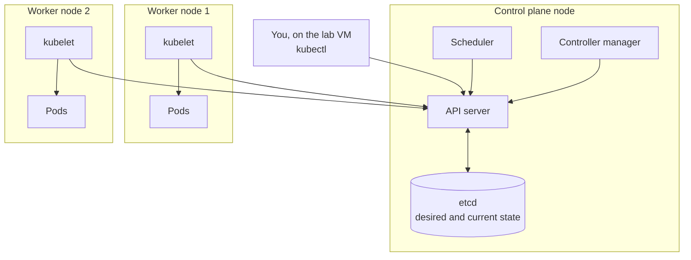
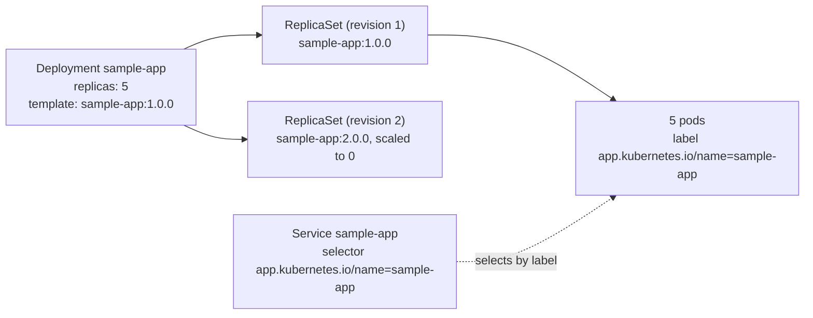

# Chapter 2: Kubernetes core

Chapter 1 ran one container on one machine, by hand. Kubernetes runs many containers on many machines and keeps them in the state you describe. In this chapter you create a small Kubernetes cluster on the lab VM, deploy the sample app to it from YAML files, and watch Kubernetes scale it, heal it, update it and roll it back.

## What you will be able to do

- Name the parts of a Kubernetes cluster and say what each one does.
- Describe an application in YAML (namespace, Deployment, Service) and apply it declaratively.
- Use labels and selectors to connect a Service to the right pods.
- Scale a Deployment, roll out a new version, and roll it back.
- Show Kubernetes replacing a pod you deleted, and explain why it happens.

## Before you start

### Prerequisites

- Chapter 1 done. The image `sample-app:1.0.0` and your `Dockerfile` are still on the lab VM. The chapter 1 registry can already be deleted, this chapter does not use it.
- The lab VM started (`scripts/lab-vm.sh start`) and an SSH session open on it (`scripts/lab-vm.sh connect`).

### Time needed

About 3 hours: 75 minutes of reading, 90 minutes for the lab, 15 minutes for the review.

### Estimated cost

The Kubernetes cluster runs inside the lab VM, so this chapter creates no new Azure resource. Prices from the Azure Retail Prices API, pay-as-you-go, region Sweden Central, in EUR, looked up on 13 November 2026.

| Item | Price | For this chapter |
| --- | --- | --- |
| Lab VM, about 3 hours | 0.0826 per hour | 0.25 |
| Disk and public IP of the lab VM | about 0.25 per day | 0.25 |

About 0.50 EUR in total.

## Concepts

### What Kubernetes does, and how a cluster is built

Kubernetes is a container orchestrator. You tell it what should run, for example "three copies of this image, reachable on this port", and it starts the containers on its machines, watches them, and corrects any difference between what runs and what you asked for. That correction never stops: it is called reconciliation, and it is what makes Kubernetes heal itself.

A cluster has two kinds of members. [Kubernetes components](https://kubernetes.io/docs/concepts/overview/components/)

- The control plane makes the decisions. The API server is the only entry point: `kubectl` and every other component talk to it. etcd is the database where the desired state and the current state are stored. The scheduler chooses a node for each new pod. The controller manager runs the control loops that reconcile, such as the one that keeps the right number of copies running.
- Nodes run the workloads. On each node, the kubelet is the agent that receives pods from the API server and asks the container runtime (containerd, CRI-O or another one) to start their containers. kube-proxy, or a component that replaces it, routes Service traffic on the node.

In this chapter, kind builds the whole cluster inside Docker on the lab VM: each node is a container, and the containers of your app run inside those node containers. [kind](https://kind.sigs.k8s.io/) It behaves like a real cluster for everything in this chapter, but it lives and dies with the lab VM.



<details>
<summary>Check yourself: you delete a pod with kubectl. Which component notices that a copy is missing, and which one starts the new container?</summary>

A controller in the controller manager notices, through the API server, that fewer pods exist than requested, and creates a new pod object. The scheduler assigns it to a node, and the kubelet of that node starts its container.

</details>

### Declarative and imperative

You can drive Kubernetes in two ways. [Kubernetes object management](https://kubernetes.io/docs/concepts/overview/working-with-objects/object-management/)

- Imperative commands say what to do now: `kubectl create deployment`, `kubectl scale`, `kubectl delete`. They are quick, but leave no record of the intended state.
- Declarative configuration says what should exist: you write YAML files that describe objects, and `kubectl apply -f <file or folder>` makes the cluster match them. Running it again changes nothing if nothing changed. The files can live in Git, be reviewed and be applied again on another cluster.

This course works declaratively, the same way the Bicep files of chapter 0 describe Azure resources.

Every Kubernetes object in YAML has the same four top-level fields:

| Field | Content |
| --- | --- |
| `apiVersion` | The API group and version of the object type, for example `apps/v1` for a Deployment |
| `kind` | The type of object: `Namespace`, `Deployment`, `Service` |
| `metadata` | The name, the namespace and the labels |
| `spec` | The desired state, which you write |

The cluster adds a fifth field, `status`, with the current state. You never write it. `kubectl explain <kind>.<field>` describes any field from the command line, for example `kubectl explain deployment.spec.replicas`.

<details>
<summary>Check yourself: you scale a Deployment to 5 with kubectl scale, then run kubectl apply on a file that says replicas: 3. How many replicas run?</summary>

Three. `kubectl apply` makes the cluster match the file, and the file says 3. The imperative change was not recorded anywhere, so the next apply undid it. This is why changes go through the files.

</details>

### Pods

A pod is the smallest unit Kubernetes runs: one or more containers that always run together on the same node, share one IP address and can share storage. Most pods hold a single container. [Pods](https://kubernetes.io/docs/concepts/workloads/pods/)

Pods are disposable. When a pod dies or its node fails, Kubernetes does not repair it: a controller creates a new pod, with a new name and a new IP address. This is why you almost never create pods directly, and why nothing should rely on the address of a single pod.

<details>
<summary>Check yourself: why should the sample app not store anything important on the file system of its pod?</summary>

The pod can be replaced at any moment, and its replacement starts from the image again, with an empty writable layer. Anything written by the old pod is lost. Storage that survives pods is the subject of chapter 3.

</details>

### ReplicaSets, Deployments and self-healing

A ReplicaSet keeps a fixed number of identical pods running. It finds its pods by their labels, counts them, and creates or deletes pods until the count matches. [ReplicaSet](https://kubernetes.io/docs/concepts/workloads/controllers/replicaset/)

A Deployment manages ReplicaSets for you, and adds updates and rollbacks on top. You describe the pods once, in the pod template of the Deployment, and say how many replicas (copies) you want. [Deployments](https://kubernetes.io/docs/concepts/workloads/controllers/deployment/)



Self-healing is the reconciliation loop at work. If you delete a pod, or its container crashes, or its node disappears, the count in the ReplicaSet no longer matches and a new pod is created. Kubernetes restarts a crashed container in place, and replaces a pod that is gone.

<details>
<summary>Check yourself: a Deployment has 3 replicas. You delete its ReplicaSet with kubectl. What happens?</summary>

The ReplicaSet and its pods are deleted, then the Deployment controller sees that its ReplicaSet is missing and creates a new one, which creates 3 new pods. The Deployment is the object that holds the desired state.

</details>

### Services

Pods come and go with new addresses, so clients need a stable way to reach them. A Service gives a set of pods one stable virtual IP address and a DNS name inside the cluster, and spreads requests across the pods. It finds the pods with a label selector, and keeps the list of their addresses in EndpointSlice objects. A pod is only listed as ready once it is ready to receive traffic. [Service](https://kubernetes.io/docs/concepts/services-networking/service/), [EndpointSlices](https://kubernetes.io/docs/concepts/services-networking/endpoint-slices/)

A Service maps a port of its own (`port`) to the port the containers listen on (`targetPort`). Its type decides who can reach it:

| Type | Reachable from | Typical use |
| --- | --- | --- |
| `ClusterIP` (the default) | Inside the cluster only, on the Service IP and DNS name | Traffic between apps |
| `NodePort` | Also from outside, on a fixed port of every node, by default between 30000 and 32767 | Quick access without any extra component, as in this lab |
| `LoadBalancer` | Also from outside, through a cloud load balancer | Chapter 6, on AKS |

In the lab, the node addresses of kind are reachable from the lab VM, so a `NodePort` Service lets you test the app with `curl` from the VM.

<details>
<summary>Check yourself: the Service exists, but its EndpointSlice lists no address. What is the most likely cause?</summary>

The Service selector does not match the labels of the pods, for example because of a typo in the key or the value. Compare `kubectl get pods --show-labels` with the selector in `kubectl describe service`.

</details>

### Namespaces

A namespace divides one cluster into named areas. Object names must be unique within a namespace, but two namespaces can each have a Deployment called `sample-app`. Most commands take `-n <namespace>`, and without it `kubectl` uses the namespace called `default`. Some objects, such as nodes and namespaces themselves, belong to no namespace. [Namespaces](https://kubernetes.io/docs/concepts/overview/working-with-objects/namespaces/)

A namespace on its own is not a security boundary. It becomes one when access rules and network rules are attached to it, which is the subject of chapter 4. On OpenShift, namespaces are wrapped in projects, as you will see in chapter 7.

<details>
<summary>Check yourself: kubectl get pods shows nothing, but you are sure the app runs. What did you forget?</summary>

The namespace. Without `-n sample-app`, `kubectl` looks in `default`. `kubectl get pods -A` lists the pods of every namespace.

</details>

### Labels and selectors

A label is a key and value pair attached to an object, such as `app.kubernetes.io/name: sample-app`. A selector is a query on labels. Labels are how Kubernetes objects find each other: a ReplicaSet finds its pods, and a Service finds the pods to send traffic to, by selector. [Labels and selectors](https://kubernetes.io/docs/concepts/overview/working-with-objects/labels/)

Kubernetes documents a set of recommended labels with the prefix `app.kubernetes.io/`, such as `name`, `version` and `part-of`, so that tools and people can read them the same way. [Recommended labels](https://kubernetes.io/docs/concepts/overview/working-with-objects/common-labels/)

In a Deployment, `spec.selector.matchLabels` must match the labels in `spec.template.metadata.labels`, and the selector cannot be changed after the Deployment is created. Choose a stable label for it, not one that changes with each version.

<details>
<summary>Check yourself: why is app.kubernetes.io/version a bad choice for the selector of a Deployment?</summary>

The version changes with every release, but the selector of a Deployment cannot change after creation. A new version would need a new Deployment. Select on a label that stays the same, such as the app name, and use the version label for information only.

</details>

### The kubectl commands you need

`kubectl` talks to the API server of the cluster named in its current context. Chapter 2 setup sets the context to `kind-aro-k8s`. [kubectl quick reference](https://kubernetes.io/docs/reference/kubectl/quick-reference/)

| Command | What it does |
| --- | --- |
| `kubectl get <kind> [-n <ns>] [-o wide or -o yaml] [--show-labels] [--watch]` | Lists objects, with more detail, as YAML, with labels, or as they change |
| `kubectl describe <kind> <name> -n <ns>` | Shows an object in detail, with recent events at the end. The first command to run when something is wrong |
| `kubectl apply -f <file or folder>` | Creates or updates objects from YAML |
| `kubectl delete <kind> <name> -n <ns>` or `kubectl delete -f <file>` | Deletes objects |
| `kubectl logs <pod> -n <ns>` | Shows the output of a container, like `docker logs` |
| `kubectl exec -it <pod> -n <ns> -- <command>` | Runs a command in a container, like `docker exec` |
| `kubectl rollout status, history, undo deployment/<name> -n <ns>` | Follows, lists and reverts the rollouts of a Deployment |
| `kubectl explain <kind>.<field>` | Documents any field |
| `kubectl create deployment <name> --image=<image> --dry-run=client -o yaml` | Prints a starting YAML file without creating anything |

<details>
<summary>Check yourself: a pod stays in the Pending state. Which command shows why?</summary>

`kubectl describe pod <name> -n <namespace>`. The events at the end of the output say what the scheduler or the kubelet is waiting for, such as missing resources or an image that cannot be pulled.

</details>

### Rolling updates and rollbacks

When you change the pod template of a Deployment, for example the image tag, the Deployment creates a new ReplicaSet and moves the replicas over gradually: it starts new pods, waits for them to be ready, and removes old ones. By default, it allows up to 25% more pods than requested (`maxSurge`) and up to 25% fewer ready pods (`maxUnavailable`) during the change, so the app stays available. [Rolling update](https://kubernetes.io/docs/concepts/workloads/controllers/deployment/#rolling-update-deployment)

Each change of the template is a revision. The old ReplicaSets are kept, scaled to zero (10 of them by default), so that `kubectl rollout undo` can bring the previous template back. A rollback is itself a new revision: after rolling out version 2 (revision 2) and undoing it, the Deployment is at revision 3, running the template of revision 1. Changing only the number of replicas is not a new revision. [Rolling back a Deployment](https://kubernetes.io/docs/concepts/workloads/controllers/deployment/#rolling-back-a-deployment)

`kubectl rollout undo` is an imperative command: your YAML file still describes the version you rolled back from. Update the file afterwards, or the next `kubectl apply` rolls the bad version out again.

<details>
<summary>Check yourself: during a rolling update, the new pods never become ready. Does the app stop answering?</summary>

No. The Deployment only removes old pods as new ones become ready, within the `maxUnavailable` limit, so the old version keeps serving. The rollout stalls, `kubectl rollout status` waits, and `kubectl rollout undo` returns to the previous revision.

</details>

### Images in a kind cluster

The nodes of a kind cluster do not see the images of the Docker engine on the lab VM. `kind load docker-image <image> --name aro-k8s` copies an image into every node. [kind quick start](https://kind.sigs.k8s.io/docs/user/quick-start/#loading-an-image-into-your-cluster)

When a tag other than `latest` is used, the default image pull policy is `IfNotPresent`: the kubelet uses the image already on the node and never contacts a registry. With `latest`, it tries to pull from Docker Hub and fails, because the image only exists locally. [Image pull policy](https://kubernetes.io/docs/concepts/containers/images/#image-pull-policy)

<details>
<summary>Check yourself: after you roll out sample-app:2.0.0, the new pods show ErrImagePull. What did you forget?</summary>

To load the new image into the cluster with `kind load docker-image sample-app:2.0.0 --name aro-k8s`. Building it on the lab VM is not enough. The old pods keep running meanwhile, because the rollout waits for the new ones.

</details>

## Knowledge check

Answers and explanations are in [knowledge-check-answers.md](knowledge-check-answers.md).

1. Which component stores the desired state of the cluster?
   - A. The kubelet.
   - B. etcd.
   - C. The scheduler.
   - D. kube-proxy.
2. You delete one pod of a Deployment that has 5 replicas. What happens next?
   - A. The Deployment drops to 4 replicas until you scale it again.
   - B. The deleted pod is restarted with the same name and IP address.
   - C. Its ReplicaSet creates a new pod with a new name, to get back to 5.
   - D. The whole Deployment is restarted.
3. A Service of type `NodePort` with `port: 80`, `targetPort: 8080` and `nodePort: 30080` receives a request on port 30080 of a node. Where does the request go?
   - A. To port 80 of one of the selected pods.
   - B. To port 8080 of one of the selected pods.
   - C. To port 30080 of every pod.
   - D. To the API server.
4. You run `kubectl rollout undo` after a bad rollout to version 2.0.0. What is still true afterwards?
   - A. Your YAML file still says 2.0.0, so the next `kubectl apply` brings it back unless you change the file.
   - B. The ReplicaSet of version 2.0.0 is deleted.
   - C. The Deployment is back to revision 1.
   - D. The pods of version 1.0.0 keep their old names.
5. Why does the lab use a `NodePort` Service rather than `ClusterIP`?
   - A. `ClusterIP` Services cannot select pods.
   - B. `NodePort` is faster.
   - C. A `NodePort` Service is reachable from outside the cluster, here from the lab VM, without any extra component.
   - D. kind does not support `ClusterIP`.

## Lab

### Goal

Run the sample app on Kubernetes from YAML files that you wrote: three replicas behind a Service, scaled to five, healed after a deleted pod, updated to version 2.0.0, and rolled back to 1.0.0.

### Tasks

Write your YAML files in `~/work/02-kubernetes-core` on the lab VM, and apply every change with `kubectl apply -f`.

1. Create a namespace called `sample-app`.
2. In that namespace, create a Deployment called `sample-app` that runs 3 replicas of `sample-app:1.0.0`. Label the pods `app.kubernetes.io/name: sample-app` and use that label as the selector. Declare container port 8080.
3. Expose the pods with a Service called `sample-app`, of type `NodePort`, on port 80, sending traffic to port 8080 of the pods, with node port 30080. Call the app through the Service from the lab VM several times and look at the host names in the answers.
4. Scale the Deployment to 5 replicas by changing your file.
5. Delete one pod and watch Kubernetes replace it. Note the names before and after.
6. Build `sample-app:2.0.0` from your chapter 1 Dockerfile, with the version set to 2.0.0, load it into the cluster, and roll it out by changing your file. Watch the rollout and call the app during it.
7. Roll back to the previous revision with `kubectl rollout undo`, then make your file match the cluster again.

Stretch goal: add a readiness probe on `/healthz` to the container, so that a pod only receives traffic once the app answers.

### Acceptance criteria

Checked by `validate.sh`:

- The cluster has 3 ready nodes: 1 control plane and 2 workers.
- The namespace `sample-app` exists.
- The Deployment `sample-app` exists, was applied with `kubectl apply` (a warning otherwise), and labels its pods `app.kubernetes.io/name=sample-app`.
- The Deployment asks for 5 replicas, and 5 are ready.
- The Deployment runs an image tagged `1.0.0`, and at least one of its ReplicaSets ran `2.0.0`, with at least 2 ReplicaSets in its history.
- The Service `sample-app` is of type `NodePort`, listens on port 80, targets port 8080, uses node port 30080 and selects `app.kubernetes.io/name=sample-app`.
- The Service has 5 ready endpoints.
- `GET /healthz` through node port 30080 answers 200, and `GET /` reports version 1.0.0.

Checked by you and the review:

- You saw a deleted pod replaced by a new one with another name, and can explain which controller did it.
- Your YAML files describe exactly what runs in the cluster, including the image after the rollback.

Useful starting points, without giving the solution away: the Concepts section above lists every field and command you need, `kubectl explain` documents any field, and `kubectl create deployment --dry-run=client -o yaml` prints a starting file. To call a node port from the VM, find the address of a node with `kubectl get nodes -o wide`.

### Run setup, validate and teardown

In your SSH session on the lab VM:

```bash
~/aro-k8s-course/chapters/02-kubernetes-core/lab/setup.sh      # creates the kind cluster, loads sample-app:1.0.0
cd ~/work/02-kubernetes-core                                     # write your YAML files here, then do the tasks
~/aro-k8s-course/chapters/02-kubernetes-core/lab/validate.sh   # checks your work, changes nothing
~/aro-k8s-course/chapters/02-kubernetes-core/lab/teardown.sh   # after the review: deletes the kind cluster
```

Setup creates the cluster from [lab/kind-cluster.yaml](lab/kind-cluster.yaml), which pins the Kubernetes version, waits for the nodes and loads `sample-app:1.0.0` into them. Creating the cluster takes 1 to 3 minutes.

If the lab VM was stopped and started again, check the cluster with `kubectl get nodes` after you reconnect. Whether a kind cluster comes back after a reboot of its machine depends on Docker restarting the node containers (not verified for this version of kind). If the nodes are not Ready after a few minutes, delete the cluster with `teardown.sh`, run `setup.sh` again and apply your files again.

If you are stuck for more than 20 minutes, compare with the [reference solution](../../solutions/02-kubernetes-core/README.md).

### Review

Open [review-prompt.md](review-prompt.md), copy the prompt into any AI assistant, and paste the output of `validate.sh`, your three YAML files, the output of `kubectl -n sample-app rollout history deployment/sample-app` and your notes from task 5 where the prompt says so.

## Clean up and cost check

- Run `teardown.sh` on the lab VM once the review is done. It deletes the kind cluster and lists what is still tagged `course=aro-k8s` in Azure. Your YAML files and your images stay on the VM.
- From your own computer, deallocate the VM: `scripts/lab-vm.sh stop`.
- This chapter adds no Azure resource, so Cost analysis only shows the lab VM, its disk and its IP address.
- If you take a long break before chapter 3, destroy the lab with `chapters/00-lab-setup/lab/teardown.sh destroy` and recreate it later with setup. You then rebuild the images from your Dockerfile.

## Sources

Prices: [Azure Retail Prices API](https://learn.microsoft.com/rest/api/cost-management/retail-prices/azure-retail-prices), queried on 13 November 2026 with `armSkuName eq 'Standard_D2as_v5' and armRegionName eq 'swedencentral'`, currency EUR.

- [Kubernetes components](https://kubernetes.io/docs/concepts/overview/components/)
- [Kubernetes object management](https://kubernetes.io/docs/concepts/overview/working-with-objects/object-management/)
- [Pods](https://kubernetes.io/docs/concepts/workloads/pods/)
- [ReplicaSet](https://kubernetes.io/docs/concepts/workloads/controllers/replicaset/)
- [Deployments](https://kubernetes.io/docs/concepts/workloads/controllers/deployment/)
- [Service](https://kubernetes.io/docs/concepts/services-networking/service/)
- [EndpointSlices](https://kubernetes.io/docs/concepts/services-networking/endpoint-slices/)
- [Namespaces](https://kubernetes.io/docs/concepts/overview/working-with-objects/namespaces/)
- [Labels and selectors](https://kubernetes.io/docs/concepts/overview/working-with-objects/labels/)
- [Recommended labels](https://kubernetes.io/docs/concepts/overview/working-with-objects/common-labels/)
- [kubectl quick reference](https://kubernetes.io/docs/reference/kubectl/quick-reference/)
- [Images and image pull policy](https://kubernetes.io/docs/concepts/containers/images/#image-pull-policy)
- [Install kubectl on Linux, version skew](https://kubernetes.io/docs/tasks/tools/install-kubectl-linux/)
- [kind quick start](https://kind.sigs.k8s.io/docs/user/quick-start/)
- [kind configuration](https://kind.sigs.k8s.io/docs/user/configuration/)
- [kind known issues](https://kind.sigs.k8s.io/docs/user/known-issues/)
- [kind release v0.33.0](https://github.com/kubernetes-sigs/kind/releases/tag/v0.33.0)
